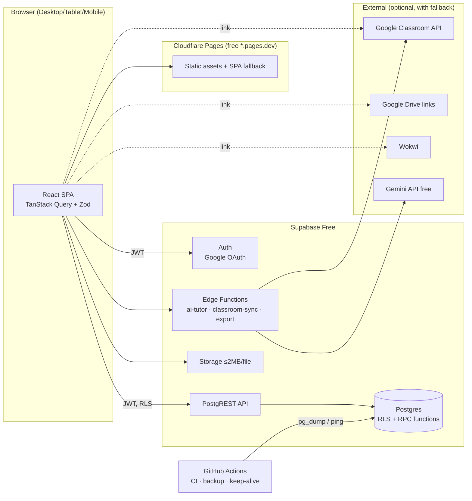
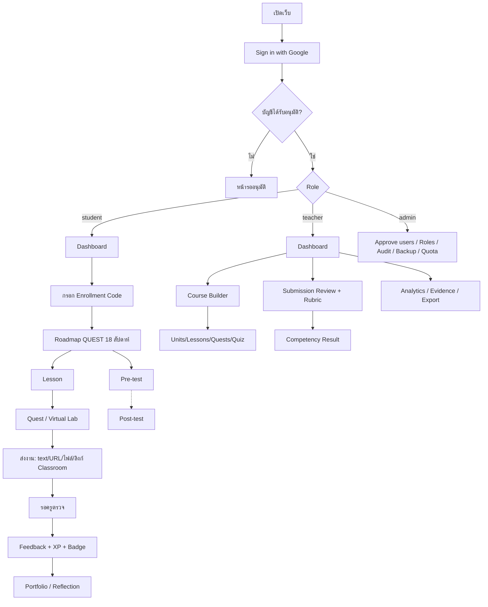

# ARCHITECTURE

## 1. ความเหมาะสมของ Technology Stack
| ส่วน | ผลประเมิน | หมายเหตุ |
|---|---|---|
| React + TS + Vite + Tailwind + shadcn/ui | ✅ เหมาะสม | SPA static → host บน Cloudflare Pages ฟรีไม่จำกัด bandwidth |
| TanStack Query | ✅ | caching ลด request; staleTime 60s, ไม่ polling ถี่ |
| Supabase (Postgres+Auth+RLS+RPC) | ✅ | ตอบโจทย์ "XP/score ที่ backend เท่านั้น" ผ่าน RPC |
| Edge Functions | ✅ เฉพาะ AI proxy, Classroom API, CSV ขนาดใหญ่ | เก็บ secrets ฝั่ง server |
| Motion | ⚠️ ใช้แบบ lazy + `prefers-reduced-motion` | ระวังขนาด bundle |
| Recharts | ⚠️ lazy-load เฉพาะหน้า analytics | ~100KB |
| ทางเลือกสำรอง | Firebase (Spark) / PocketBase บน host ฟรี | ไม่แนะนำ: ไม่มี RLS/SQL, host ฟรีไม่เสถียร |

## 2. System Architecture


## 3. หลักการสำคัญ
1. **Trust boundary**: Client อ่านข้อมูลผ่าน RLS; ทุกการเปลี่ยนสถานะที่มีผลต่อคะแนน/XP/badge/competency ทำผ่าน RPC (`SECURITY DEFINER`, `search_path=''`) เท่านั้น — ตารางเหล่านี้ไม่มี INSERT/UPDATE policy สำหรับ student
2. **Data-driven courses**: รายวิชา/สมรรถนะ/level/badge เป็นข้อมูล ไม่มี hardcode รายวิชา IoT ในโค้ด
3. **Graceful degradation**: Feature flags ใน `system_settings` (`ai_tutor.enabled`, `classroom_api.enabled`, `leaderboard.enabled`, `wokwi.embed`) — ปิดแล้วระบบหลักยังทำงาน
4. **Idempotency**: `xp_transactions` unique `(user_id, source_type, source_id, reason)`; RPC รับ `idempotency_key`
5. **No realtime by default**: ใช้ refetch on focus + invalidate หลัง mutation
6. **Time**: เก็บ `timestamptz` (UTC) แสดงผล `Asia/Bangkok`; ใช้ `date_trunc` ใน TZ Bangkok สำหรับ daily quest/streak

## 4. RPC หลัก (รายละเอียดใน API.md)
`approve_user`, `set_user_role`, `join_course_by_code`, `clone_course`, `complete_lesson`, `submit_quest`, `review_submission`, `start_quiz_attempt`, `submit_quiz_attempt`, `grade_answer`, `award_badge`, `record_competency_result`, `get_leaderboard`, `get_teacher_dashboard`, `export_course_data`

## 5. Folder Structure
```
classquest/
├─ apps/web/                    # Vite React app
│  ├─ src/
│  │  ├─ app/                   # router, providers, layouts, error boundary
│  │  ├─ components/ui/         # shadcn/ui (generated)
│  │  ├─ components/common/     # EmptyState, ErrorState, Skeletons, ConfirmDialog
│  │  ├─ features/              # feature-based (ui + hooks + api + schema + tests)
│  │  │  ├─ auth/ courses/ learning/ quests/ gamification/
│  │  │  ├─ assessment/ competency/ classroom/ labs/ ai-tutor/
│  │  │  ├─ analytics/ portfolio/ evidence/ admin/
│  │  ├─ lib/                   # supabase client, query client, i18n, date (Asia/Bangkok), flags
│  │  ├─ styles/                # tokens.css, globals.css
│  │  └─ types/database.ts      # generated by supabase gen types
│  └─ e2e/                      # Playwright
├─ supabase/
│  ├─ migrations/               # timestamped SQL
│  ├─ functions/                # edge functions (Deno)
│  ├─ tests/                    # pgTAP RLS tests
│  ├─ seed.sql                  # DEV ONLY (demo IoT course + 30 fake students)
│  └─ config.toml
├─ tests/load/                  # k6 scripts
├─ docs/ adr/ manuals/ (ไทย)
└─ .github/workflows/           # ci.yml, backup.yml, keepalive.yml
```
Feature folder convention: `features/quests/{components,hooks,api.ts,schemas.ts,types.ts,routes.tsx,__tests__}`

## 6. User Flows

