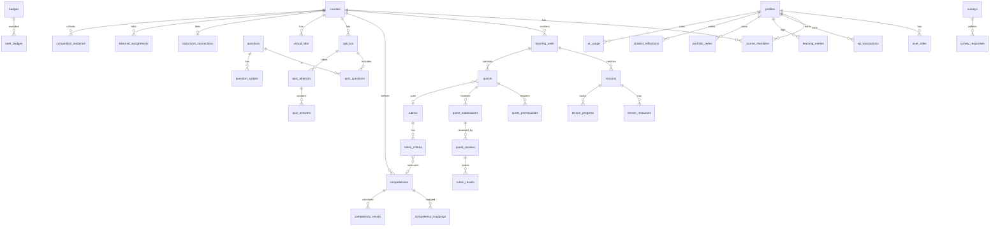

# DATABASE

ทุกตาราง: `id uuid pk default gen_random_uuid()`, `created_at timestamptz default now()`, `updated_at` (trigger), RLS **enabled**. ปรับจากรายการตั้งต้น: รวม `assessments` เข้ากับ `quizzes` (`quizzes.kind`), เพิ่ม `quest_stages`→ใช้ enum, เพิ่ม `enrollment_codes`, `badge_rules`, `anonymous_codes`, `feature_flags` อยู่ใน `system_settings`

## ER Diagram

## ตารางหลัก (คอลัมน์สำคัญ)
| Table | Key columns | Constraints / Index |
|---|---|---|
| profiles | id = auth.users.id, display_name, nickname, student_code (nullable), avatar_url, status(pending/active/suspended), leaderboard_opt_in | unique(student_code) |
| user_roles | user_id, role(enum admin/teacher/student), granted_by | unique(user_id, role); เขียนได้ผ่าน RPC admin เท่านั้น |
| courses | code, name, level(ปวช/ปวส), classroom, term, academic_year, description, cover_path, status, weeks default 18, settings jsonb, source_course_id | unique(code, term, academic_year, classroom) |
| course_members | course_id, user_id, member_role(teacher/student) | unique(course_id,user_id); idx(user_id) |
| enrollment_codes | course_id, code, expires_at, max_uses, uses | unique(code) |
| learning_units | course_id, week_no, title, order | unique(course_id, order) |
| lessons | unit_id, title, body_md, quest_stage, unlock_rule jsonb, order, published | idx(unit_id, order) |
| lesson_resources | lesson_id, type(enum text/image/video/pdf/drive/slides/youtube/code/external/interactive/lab), url, storage_path, meta | — |
| lesson_progress | lesson_id, user_id, status, completed_at | unique(lesson_id,user_id) |
| quests | unit_id, type(main/side/daily/weekly/challenge/boss), title, description, objectives, difficulty 1–5, max_score, xp_reward, due_at, submit_modes text[], rubric_id, max_resubmissions, quest_stage | idx(unit_id) |
| quest_prerequisites | quest_id, required_quest_id | pk(quest_id, required_quest_id), check(≠) |
| quest_submissions | quest_id, user_id, attempt_no, content_text, url, storage_path, status(submitted/returned/approved), submitted_at | unique(quest_id,user_id,attempt_no) |
| quest_reviews | submission_id, reviewer_id, score, feedback, decision | — |
| rubrics / rubric_criteria / rubric_results | criteria: name, competency_id, levels jsonb, weight; results: review_id, criterion_id, level, score | unique(review_id, criterion_id) |
| quizzes | course_id, unit_id, kind(pretest/posttest/quiz/practical), time_limit, shuffle, questions_per_attempt, answers_visible_at, max_attempts | — |
| questions | course_id, bank_tag, type(mc/tf/short), stem, explanation, competency_id | — |
| question_options | question_id, label, **is_correct** | **ไม่ให้ student SELECT คอลัมน์นี้** (ใช้ view `question_options_public`) |
| quiz_attempts | quiz_id, user_id, attempt_no, question_ids uuid[], started_at, submitted_at, score (server) | unique(quiz_id,user_id,attempt_no) |
| quiz_answers | attempt_id, question_id, option_id/answer_text, is_correct, points, graded_by | unique(attempt_id, question_id) |
| xp_transactions | user_id, course_id, amount, source_type, source_id, reason, created_by | **unique(user_id, source_type, source_id, reason)**; append-only |
| level_definitions | course_id null=global, level, xp_threshold, title | unique(course_id, level) |
| badges / badge_rules / user_badges | rule jsonb (e.g. quests_completed ≥ n) | unique(user_id, badge_id, course_id) |
| competencies | course_id, code, name, description, parent_id (skill tree), pass_threshold | unique(course_id, code) |
| competency_mappings | competency_id, target_type(lesson/quest/quiz/question/lab), target_id, weight | unique(competency_id,target_type,target_id) |
| competency_results | competency_id, user_id, level, score, evidence_type, evidence_id, assessed_by | idx(user_id, competency_id) |
| virtual_labs | course_id, lesson_id, platform(wokwi), project_url, allow_embed, instructions_md, diagram_path, source_code, expected_result | — |
| classroom_connections | course_id, gc_course_id, gc_link, connected_by, mode(link/api) | **ไม่เก็บ refresh token ใน table ที่ client อ่านได้** (schema `private`) |
| external_assignments | course_id, quest_id, gc_coursework_id, url, last_synced_at | — |
| learning_events | user_id, course_id, event_type, target_id, occurred_at | idx(course_id, occurred_at); partition-ready, retention 1 ปี |
| portfolio_items | user_id, course_id, item_type, ref_id, title, visibility(private/teacher/public_anonymous) | — |
| student_reflections | user_id, target_type, target_id, body | — |
| competition_evidence | course_id, category(enum 13 หมวด), title, body_md, url, storage_path, version | — |
| surveys / survey_responses | questions jsonb / answers jsonb, anonymous bool | unique(survey_id,user_id) |
| anonymous_codes | course_id, user_id, code (e.g. S-07) | unique(course_id,user_id), unique(course_id,code) |
| ai_usage | user_id, day (date Bangkok), requests, tokens_in, tokens_out | unique(user_id, day) |
| audit_logs | actor_id, action, entity, entity_id, before jsonb, after jsonb | append-only, idx(created_at) |
| system_settings | key, value jsonb | pk(key) |

## Transaction & Idempotency
- `review_submission(submission_id, decision, score, rubric jsonb, idempotency_key)` → ใน transaction เดียว: insert review, rubric_results, competency_results, ถ้า approved ครั้งแรก → insert xp (ON CONFLICT DO NOTHING), ประเมิน badge rules, insert audit_log
- `submit_quiz_attempt(attempt_id, answers jsonb)` → ล็อก attempt `FOR UPDATE`, ปฏิเสธถ้าส่งแล้ว/หมดเวลา, ตรวจกับ `is_correct` ฝั่ง server

## Migrations & Seed
- `supabase/migrations/*` ผ่าน Supabase CLI; ห้ามแก้ migration ที่ merge แล้ว
- `supabase/seed.sql` = DEV ONLY: รายวิชา 31910-2012, 18 สัปดาห์, Mission 01–09 + Boss, 30 นักเรียนชื่อสมมติ `student01@example.test` (โดเมน .test ห้าม deploy) — CI ตรวจว่า production ไม่รัน seed

## Retention (PDPA)
learning_events 1 ปี; ai_usage 90 วัน (aggregate); ลบบัญชีตามคำขอ → anonymize profiles, คง aggregated evidence
